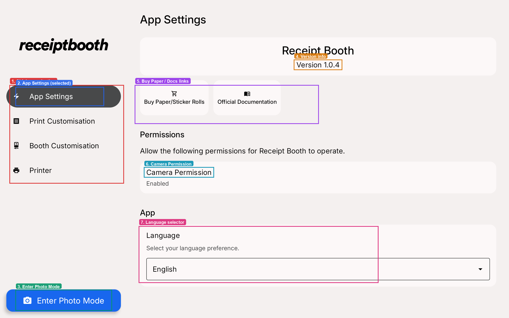

# App overview and updates

The Receipt Booth app runs the guest photo screen, controls your print layout and talks to the printer. We update it regularly with new features and fixes. It is available in all countries and only works with our printers and tablets.

[Download the app from the Play Store](https://play.google.com/store/apps/details?id=com.receiptbooth.receiptbooth)

## App overview (tablet, landscape)

The settings home screen uses a sidebar on the left and content on the right. From here you configure the booth, print layout, and printer, then start photo mode for guests.

1. **Sidebar navigation** — App Settings, Print Customisation, Booth Customisation, Printer.
2. **App Settings** — general app info and preferences (selected).
3. **Enter Photo Mode** — starts the guest-facing camera experience.
4. **Version info** — installed app version.
5. **Buy Paper / Docs links** — order rolls or open this documentation.
6. **Camera Permission** — must be enabled for photo mode.
7. **Language selector** — preferred app language.

## Upcoming features
1. 4-cut photo print outs!
2. Gifs + scannable QR codes!

--- 

## v1.0.4 (July 18, 2026)

### What’s new in 1.0.4

1. The review screen now shows your original, unedited photo, so what you see reflects the shot itself before print adjustments are applied.
2. The brightness control now goes up to 200%
3. Rename or delete your saved themes right from My Themes, and sort your collection by name or by newest and oldest.

## v1.0.3 (June 10, 2026)

### What’s new in 1.0.3

1. Better dark print quality — Improved image processing reduces visible line and banding artifacts in darker areas, so photos and templates print more evenly.
2. Smoother dithering across styles — All image-smoothing options (including Sierra Lite) now produce cleaner, more consistent results in dark and mid-tone regions.
3. Print quality improvements — Lighter gray areas remain sharp and natural while dark regions retain more detail and tonal depth.

## v1.0.2 (June 1, 2026)

### What’s new in 1.0.2

1. App Settings links — Buy paper/sticker rolls or view official documentation in your browser.
2. Smarter multiple print flow — Turn on auto-dismiss so the extra-copies screen returns automatically when guests don’t respond (set the delay in Booth Customisation).
3. App Settings improvements — Fixed language selection, cleaner full-width layout on tablets, and accurate version info.

## v1.0.1 (May 25, 2026)

### What’s new in 1.0.1

1. Theme editor — Customize capture and review screens.
2. Print template editor — Design receipts with text, images, and adjustable height.
3. Per-theme layouts — Each theme can have its own print design.
4. Extra copies — Guests can print more copies after the first (optional, in settings).
5. Kiosk fixes — Landscape mode, clearer print status, and better photo/layout handling.

## v1.0 (May 19 2026)

### What's new in 1.0:
1. Automatic photo booth app to take photos and print
2. Fully customisable print templates and app screens
3. Adjust sound effects, print brightness & textures, and more!