# Online photos

After a guest presses **Print**, the booth screen shows a QR code. The guest scans it with their phone and their photo opens on a web page. Nothing to download, no account to make.

{/* TODO(boss): is Online photos free for every booth owner and for renters? The old page said "free on every booth"; no source for it. */}

:::note
Online photos arrive with app version 1.1. If your **Version** (bottom of the Home screen) is older than 1.1, update the app first. See [App overview and updates](./app.mdx).
:::

## What guests get

The guest scans the code on the booth screen and a page opens at **photos.receiptbooth.com**.

{/* TODO(screenshot): the guest page on a real phone: photo, Save photo, Share, clip, Save as GIF, Save as video, Online until. The mock-ups from 22 Nov are not used. */}

- **The photo.** Tap **Save photo** to keep it on the phone, or **Share** to send it to friends.
- **A short clip of the countdown.** Tap **Save as GIF** or **Save as video**.
- **The date it is online until.** Shown at the bottom of the page as **Online until** and a date.

The page follows the language of the guest's phone. It carries the Receipt Booth logo only, not your own logo.

Good to know:

- The online photo is the picture of the whole print design, in true colour. It is not brightened like the paper print, and it does not show the QR code.
- If you switch the countdown clip off, guests get the photo only. While the clip records, a small red dot shows beside the countdown number on the booth screen.
- Retakes never go online. A photo goes online only once the guest presses **Print**.
- Extra copies and reprints use the same QR code and the same page.

## Turn it on

Online photos are off until you switch them on.

1. Tap **Booth** in the sidebar, then the **Saving** tab.
2. Switch **Online photos (QR)** on. The line under it reads "Guests scan a code on the screen to get their photo on their phone."
3. Leave **Include countdown clip** on if you want guests to get the clip as well. Its line reads "Guests also get a short clip of the countdown." **Include countdown clip** and **QR style** are greyed out while **Online photos (QR)** is off.

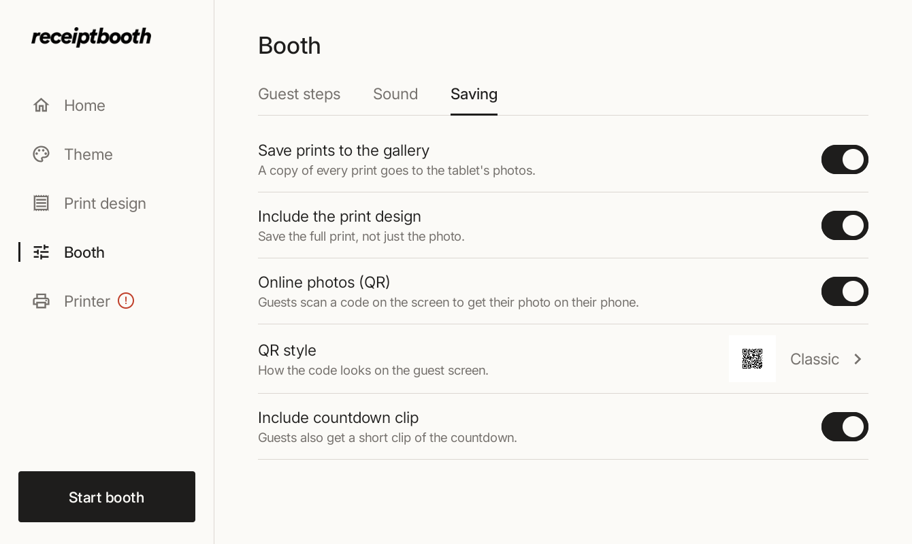

Now take a test session. After you press **Print**, the screen shows the QR code and the line **Scan to get your photo**. Scan it with your own phone to check.

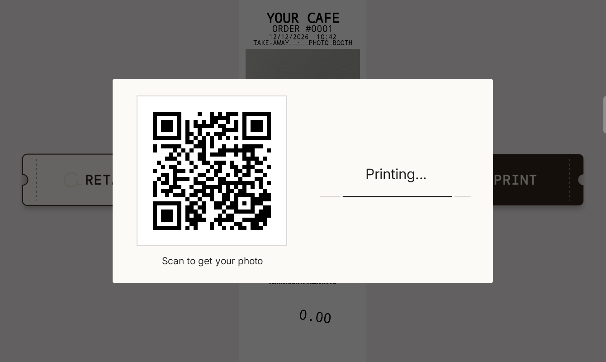

The code stays on screen after the print finishes, next to a **Done** button with a countdown in brackets, for example **Done (24)**. It starts at 30 seconds, and every touch on the screen adds a few seconds, up to a minute. A guest taps **Done** when they have finished, or the screen closes by itself. The next guest never sees the previous guest's code.

The **Home** screen has an **Online photos** line that tells you where the photos are. Tap it to open the list (see [See and remove online photos](#see-and-remove-online-photos)).

| Home says | Meaning |
|---|---|
| **Off** | The switch is off and nothing is left over. Tapping the line takes you to **Booth**, **Saving**. |
| **All photos online** | Every photo has gone up. |
| **2 waiting for internet** | The tablet has no internet. The photos go up when it comes back. |
| **2 are going online** (**1 is going online**) | The tablet has internet and the photos are on their way. |
| **1 needs attention** (**2 need attention**) | A photo could not go online. Shown in red. See [Photos that need attention](#photos-that-need-attention). |

If more than one applies, **needs attention** comes first, then the waiting lines.

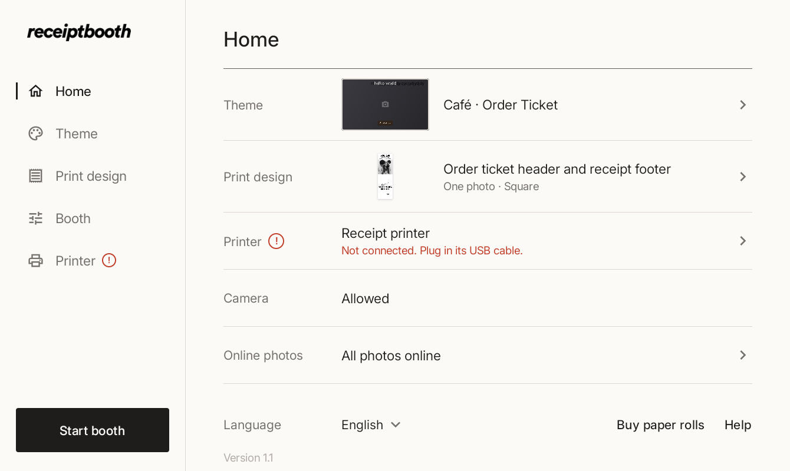

## QR styles

You can change how the code looks on the guest screen. Every style is black on a white card.

1. Go to **Booth**, **Saving**.
2. Tap **QR style**. The line under it reads "How the code looks on the guest screen."
3. Pick **Classic**, **Dots**, **Rounded** or **Ticket**, then tap **Done**.

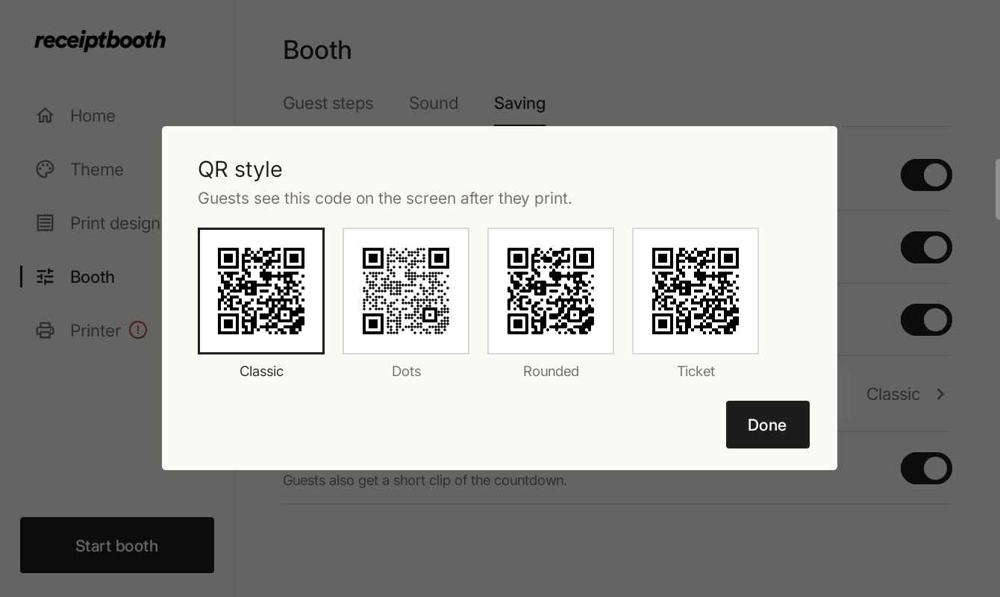

**Ticket** draws a ticket-style card with a tear line. This is how it looks on the guest screen:

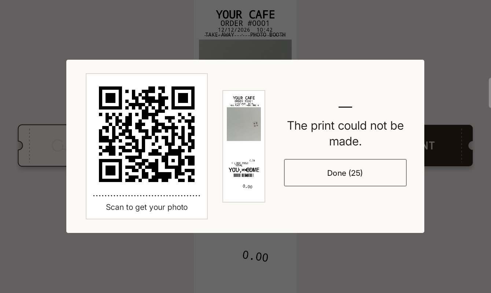

The code printed on your design has its own **Style** (see below). The two are set separately.

{/* TODO(boss): recommend a QR style (for example "If you are unsure, keep Classic")? Left open on purpose. */}

## Put the QR on your print design

You can also print a QR code on the receipt or film itself, so guests can scan it later. This is optional. Each guest's printed code is their own. The code on the paper opens the same page as the code on the screen.

1. Open **Print design** in the sidebar. Under **In use**, tap **Edit design**. (To change another design, tap **All print designs** and then **Edit** next to it.)
2. Tap **QR code** in the top bar. A design has one QR code. If it already has one, this selects it.
3. In the **QR code** panel, set the **Size** with **Smaller** and **Bigger**, and pick a **Style**.
4. Under **Place on the paper**, tap **Left**, **Centre** or **Right**. You can also drag the code like a picture, and drag the square at its corner to resize it.
5. Tap **Done**.

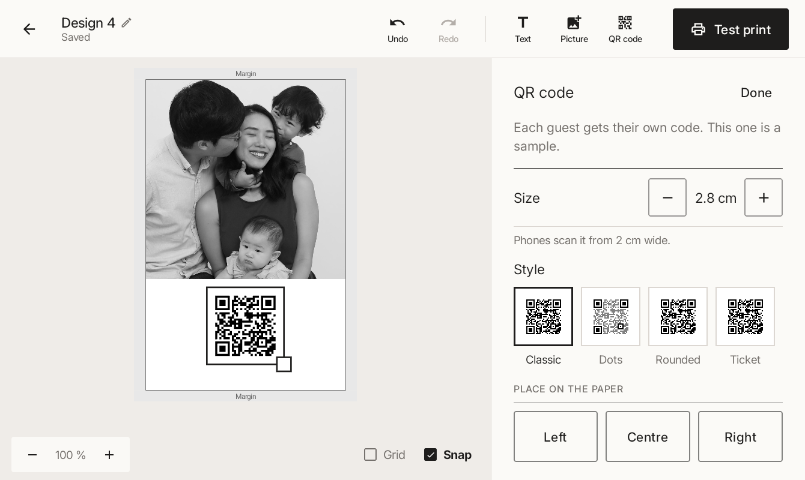

The panel says "Each guest gets their own code. This one is a sample." On a receipt design a new code is placed under what is already on the paper, and the paper grows if there is not enough room.

To remove the code, tap **Delete QR code** at the bottom of the panel. The app asks "Delete the QR code?" and tells you "Guests will no longer get a code on their print." Tap **Delete** to go ahead.

**Size.** The editor will not let you make the code smaller than the smallest size it allows. At that size it says **Smallest size that scans well.** Above that it says "Phones scan it from 2 cm wide." Some styles need more room than others. If the code is too small for **Dots**, that style is greyed out and a line under the styles tells you the size it needs, for example "Dots needs 2.8 cm or more on receipt paper."

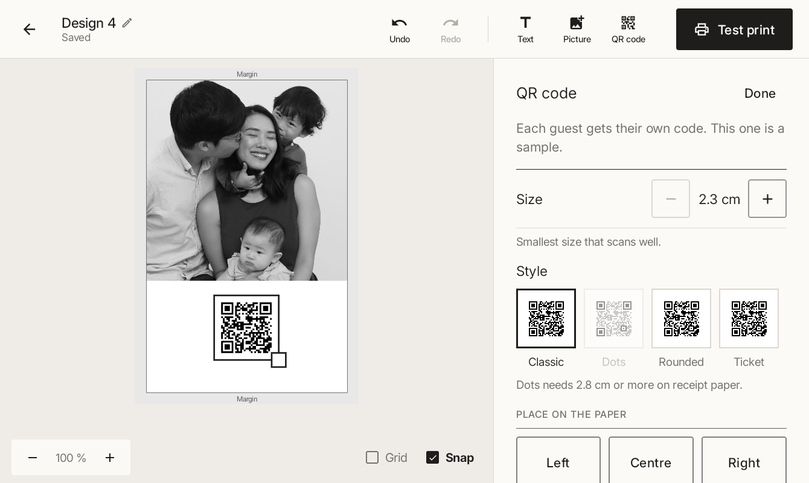

:::caution Do a test print first
Do a test print and scan it with a phone before every event, in the real lighting, with the real paper.
:::

{/* TODO(boss): add recommended QR print sizes once the code has been tested on real receipt paper and film. */}

**If Online photos is off.** A design with a QR code does not print the code while **Online photos (QR)** is off. In the editor, the QR panel says "Online photos are off, so this code will not print." with a **Turn on** button. When you tap **Start booth**, the app also warns you:

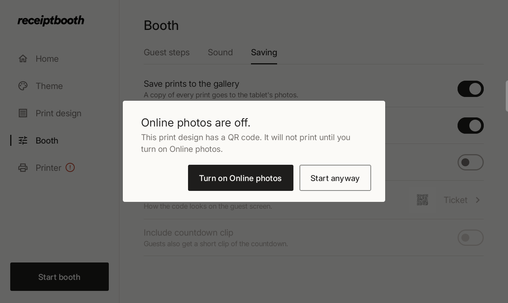

Tap **Turn on Online photos** to switch it on, or **Start anyway** to carry on without the code on the paper.

**Film designs (Instax Polaroid).** {/* TODO(boss): Instax Polaroid, ships in 1.1? */} You can add a QR code to a film design in the same way: **Print design**, edit the design, **QR code** in the top bar. The panel is the same, except the placing heading reads **Place on the film**. The code is kept inside the part of the picture the film card shows, and a new code starts in the bottom right corner of the picture at the smallest size the editor allows. The film screens on the booth show the code too.

## No internet at the venue

Online photos need internet only to send the photo and clip up. Taking and printing do not wait for it: the photo is saved on the tablet first and sent afterwards.

- Photos wait on the tablet. They go up by themselves when the internet is back. You do not need to do anything.
- A Wi-Fi connection that has no internet in it counts as no internet.
- If a guest scans while the photo has not gone up yet, the page says **Your photo is on its way**, shows "It appears here by itself as soon as the booth sends it.", and adds "Keep this page, or take a screenshot to come back later." The photo appears by itself when it arrives.
- The booth screen changes the line under the code to **Scan now, your photo will arrive later**.

**When you tap Start booth with no internet** (and Online photos on), the app asks first. It says **No internet. Photos will go online later.** and "Guests can still scan the code. Their photo goes online when the tablet has internet." Tap **Start anyway** to carry on, or **Cancel**.

On **Home**, the **Online photos** line says how many photos are waiting, for example **2 waiting for internet**. In the list, they sit under **Waiting for internet** with the line "They go online by themselves when the tablet has internet." Once the tablet has internet again the heading changes to **Going online** and the line to "They go online by themselves in a moment."

The 30 days start when the photo goes up, not when it was taken, so a late photo still gets its full time.

The booth tries again by itself and spaces its attempts out, so it does not flood a weak connection. Photos that are waiting for internet are not dropped.

{/* TODO(boss): the "No internet" section is written from how the app is built; not yet tried on a tablet with the internet switched off. */}

**If you use a phone hotspot**, the photo and clip use some mobile data for every session. In one test a session sent a little over 1 MB (the photo about 0.5 MB, the GIF about 0.15 MB, the video about 0.6 MB). Plan for about 2 MB per session. This comes from one test with one print design: a longer design or a busy clip can be bigger.

## When the app asks before Start booth

With Online photos in play, **Start booth** can ask one more thing first. It asks after any "not ready" question (see [App overview](./app.mdx#start-booth-when-the-app-asks-first)).

- **Online photos are off.** Your print design has a QR code but the switch is off. Tap **Turn on Online photos**, or **Start anyway** (the code will not print).
- **No internet. Photos will go online later.** "Guests can still scan the code. Their photo goes online when the tablet has internet." Tap **Start anyway**, or **Cancel**.

## See and remove online photos

1. On **Home**, tap **Online photos**.
2. The list says **Each photo stays online for 30 days.** Each row shows the time it was taken, for example **Today, 17:39**, and **Online until** a date. Photos are grouped under **Online**, with the number beside it.

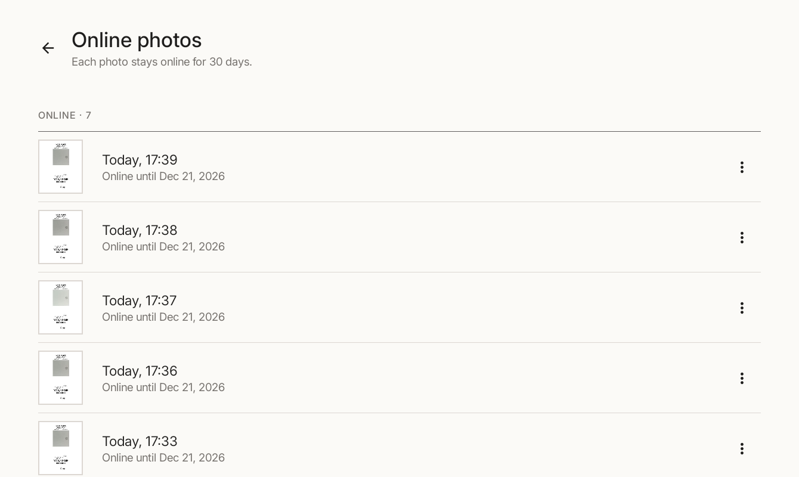

To take photos off the internet, tap the three dots (**More**) on a row. The menu is called **Remove from the internet**:

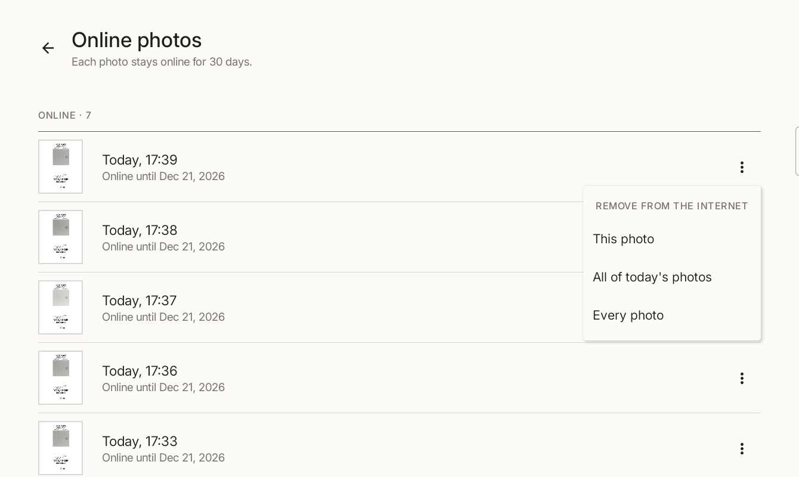

- **This photo** removes that one photo.
- **All of today's photos** removes every photo taken today.
- **Every photo** removes all of them. This includes photos that are still waiting to go up: they are taken off the tablet's list too and never go online.

The app asks you to confirm, for example **Remove this photo from the internet?**

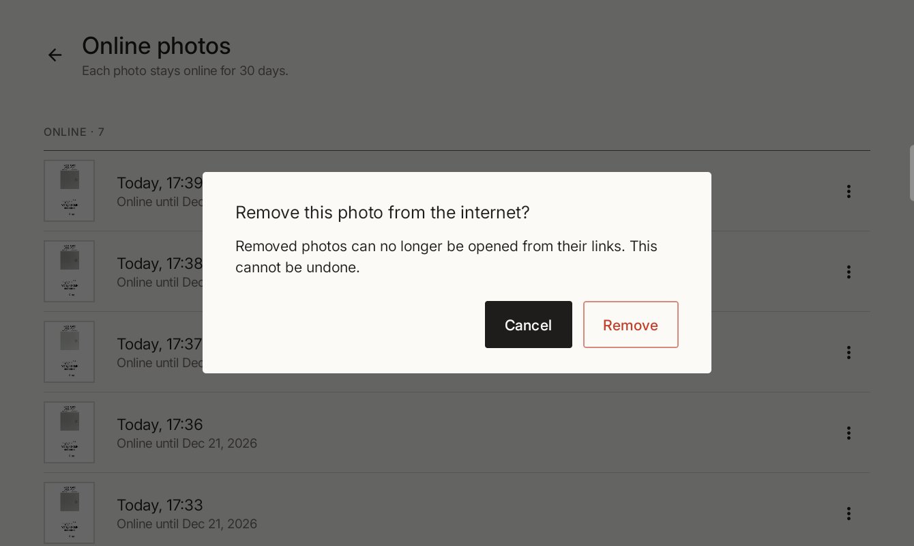

The box says "Removed photos can no longer be opened from their links. This cannot be undone." Tap **Remove** to go ahead or **Cancel** to stop. The app then says **Removed.** After removal, the link shows **This photo is no longer online** and "It has been removed."

Removing needs internet. With no connection the app says "The tablet has no internet. Nothing was removed. Try again when it has internet." If something else goes wrong it says "Could not remove. Try again."

Removing only takes the photo off the internet. The paper print stays with the guest, and the copy saved in the tablet's gallery (if **Save prints to the gallery** is on under **Booth**, **Saving**) is not touched.

:::tip
A client asks for a photo to come down at an event? Open the list and remove it there.
:::

### Photos that need attention

If a photo cannot go online, it moves to the top of the list under **Need attention**, with the count beside it. Home shows the same count in red, for example **1 needs attention**. Each such row says "Could not go online." and has a **Try again** button. Above the rows, **Try all again** tries every one of them. A photo gets here when the service refuses it, or when it has kept failing for about a week with a connection. It stays on the tablet until you try again or remove it.

If **Try again** does not help, [contact support](../contact-support.mdx) and tell us your app **Version**.

## How long photos stay online

- Photos stay online for **30 days** after they go up.
- After that the photo and clip are deleted. The guest's link then shows **This photo is no longer online** and "Photos stay online for 30 days."

Tell guests to save their photo soon after the event. Once a photo is saved to their phone, it is theirs to keep.

## Troubleshooting

**The guest scans and sees "Your photo is on its way."** The photo has not gone up yet. Check the **Online photos** line on **Home**, and that the tablet is on Wi-Fi with internet. The page updates by itself. See [No internet at the venue](#no-internet-at-the-venue).

**No QR code appears after Print.** Check **Booth**, **Saving**, and that **Online photos (QR)** is on.

**The screen says "The print could not be made."** The photo is not lost. The QR code stays on the screen and the guest can still get their photo online. Check the printer. See [The printer is not connecting](../troubleshooting.mdx#the-printer-is-not-connecting).

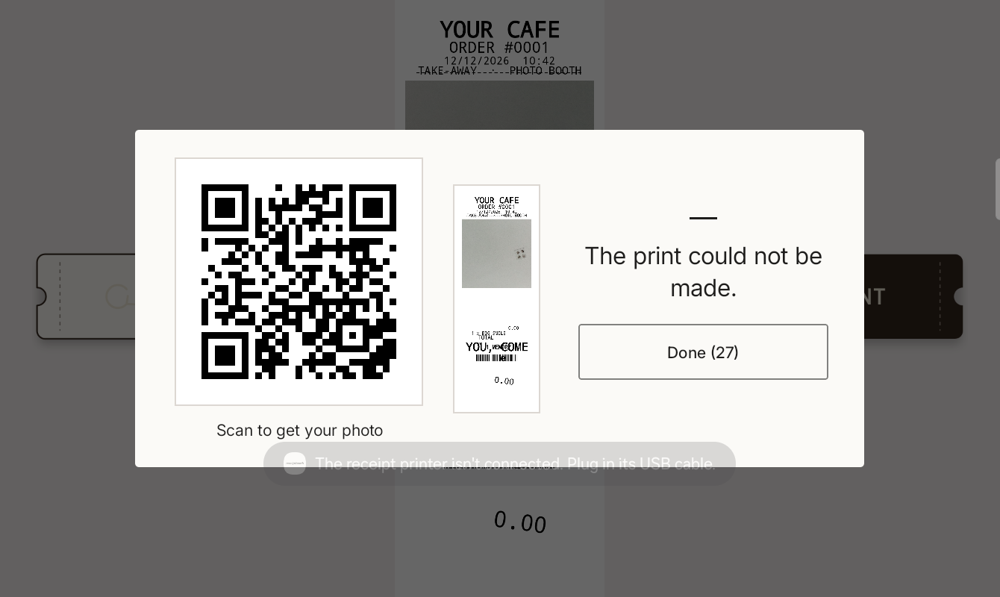

**The QR code is not on the print.** Check that **Online photos (QR)** is on, and that your print design has a **QR code** in it.

**A guest cannot save the photo.** If the guest opened the link inside another app (WeChat, Instagram, LINE, Facebook, TikTok, KakaoTalk or Snapchat), the page shows the photo with the line "Press and hold the photo to save it." instead of the **Save photo** button, and under the clip "Press and hold the clip to save it as a GIF." For the video it says "For the video, tap ··· at the top and open this page in your browser." So: press and hold the photo, then choose to save it.

**The guest sees "This photo is no longer online."** Either 30 days have passed, or the photo was removed from the list. We cannot bring it back.

**A photo shows "Need attention" in the list.** Tap **Try again**. See [Photos that need attention](#photos-that-need-attention).

Still stuck? [Contact support](../contact-support.mdx) and tell us your app **Version**.
