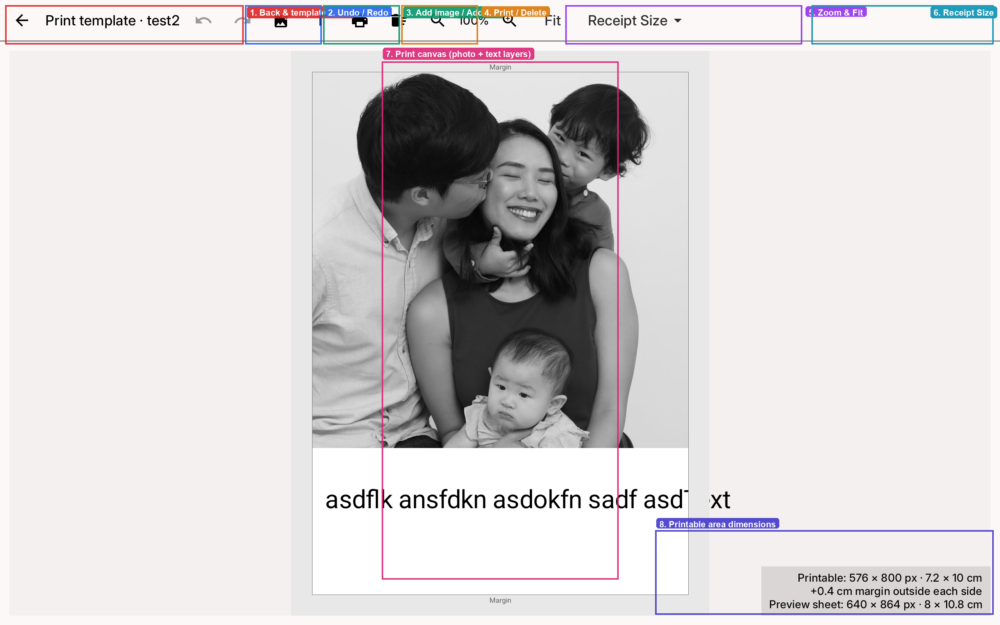

# Template editor

Open **Print Customisation**, then tap **Edit print template** to design the receipt layout for the active theme.

## Toolbar

1. **Back & template name** — return to Print Customisation; the active theme name is shown in the title.
2. **Undo / Redo** — step through recent edits.
3. **Add image / Add text** — place new image or text layers on the receipt.
4. **Print / Delete** — send a test print or remove the selected layer.
5. **Zoom & Fit** — zoom the canvas or fit the full receipt in view.
6. **Receipt Size** — choose the receipt dimensions for this template.

## Canvas

7. **Print canvas** — arrange photo and text layers inside the printable area. Drag layers to reposition them.
8. **Printable area dimensions** — shows the printable size (px / cm), margin, and preview sheet size.

Each theme can have its own print template. Changes here apply to the theme currently selected under Booth Customisation.
