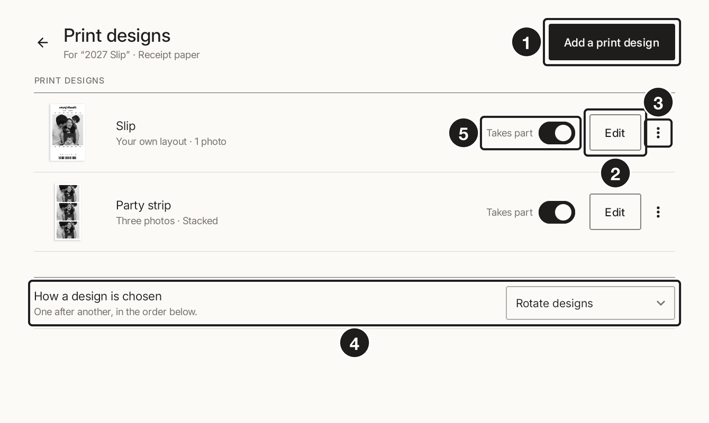
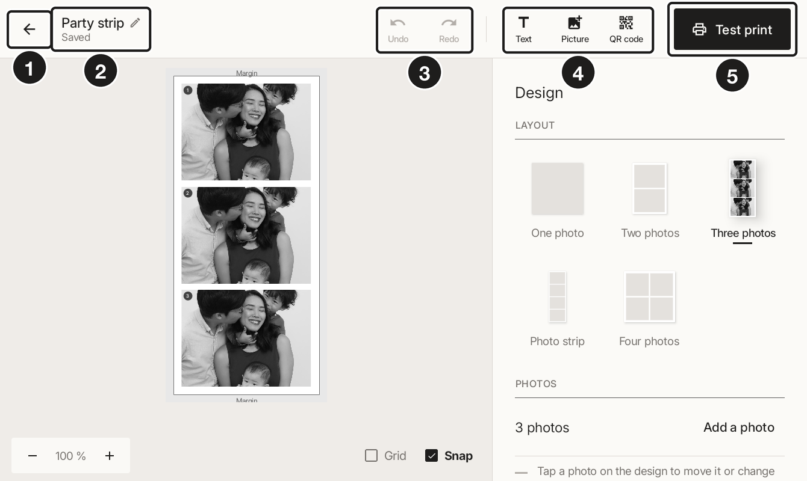

# Print design editor

Each theme has its own print designs. The editor is where you change one.

## Open it

1. Open **Print design** in the menu.
2. Under **In use**, tap **Edit design**.

To change a different design, tap **All print designs**, then **Edit** next to it. Use the arrow at the top left to go back.

## All print designs

1. **Add a print design** — makes a new design and opens it.
2. **Edit** — opens the editor for that design.
3. **More actions** (three dots) — **Rename**, **Duplicate** or **Delete**. The app asks first before it deletes: "The design and its pictures are deleted. This cannot be undone." The last design cannot be deleted.
4. With two or more designs, **How a design is chosen** sets how they are used. Under it, a line says what it does.
   - **Use one design** — "Every guest gets the same design." Then pick which one under **Design**.
   - **Shuffle designs** — "Each design once, in a new order every round."
   - **Rotate designs** — "One after another, in the order below."
   - **Random** — "Any of the designs, each time."
5. **Takes part** — a switch on each row (when designs take turns). Switch a design off and it is **Not used**. At least one design must stay in use. (The picture shows **Rotate designs**, so every row has this switch.)

## The editor

### Top bar

1. **Back arrow** — back to your designs.
2. **Design name** — tap it to rename. Under it the editor says **Saved** (or **Saving…**). Changes save as you go.
3. **Undo and Redo** — step back or forward.
4. **Text**, **Picture** and **QR code** — add words, a picture, or a QR code for [Online photos](./online-photos.mdx). A design has one QR code.
5. **Test print** — print the design as it is.

### The design on the canvas

- Tap a photo, picture or text to select it. Its panel opens on the right. Drag to move it. Drag the square at a corner to change its size.
- **Zoom out**, **Zoom in** and **Fit** — look closer, or fit the whole design on screen.
- **Grid** and **Snap** — see [Grid and snap](#grid-and-snap).
- If part of the design is off the paper, the editor says "Part of it is off the paper and will not print." Tap **Fit it on**.

### The Design panel

With nothing selected, the panel on the right is **Design**.

#### Photo layout

**Layout** sets how many photos the print has and where they sit.

| Receipt paper | Shape |
|---|---|
| **One photo** | Square |
| **Two photos** | Stacked |
| **Three photos** | Stacked |
| **Photo strip** | Four photos, stacked |
| **Four photos** | Two by two |

Choosing a layout changes the design you are editing. If it would replace something you made (photo areas you placed, or text and pictures that must move), the app asks first, for example "Change the layout of “Design 1”?" and tells you what changes. Tap **Change layout**, or **Cancel**. Everything else stays.

With several photos, guests take them one after another. [Show photo thumbnails](./templates.mdx#booth-what-guests-do) in **Booth** lets guests watch each one appear.

#### Photos

**Add a photo** adds a photo area. Tap a photo on the design to move it or change its size. Its panel says **Photo 1 of 2**, "Drag the photo to move it. Drag the square at its corner to change its size." and **Remove photo 1**.

#### Paper length (receipt paper)

How much paper each print uses. The panel says "Each print uses this much paper", with the length and width in cm, and "Photos and words keep their size and place."

- **Length** — tap **Shorter** or **Longer**.
- **Fit to what is on it** — trims the empty paper at the bottom.
- **Advanced** — **Exact length** (type a length in cm and tap **Set**), **Common lengths** (**Shortest** and a few cm sizes), and **Add 1 cm at the top**.

If making the paper shorter would remove things, the app asks "Shorten the paper?" and tells you how many. Tap **Shorten**, or **Cancel**. You can undo it.

#### Reset design

At the bottom of the Design panel. The app asks "Reset this design?" and says what happens:

- A design that came with its theme goes back to how it came: the photos, the paper length, and any text and pictures. Everything you changed on it is lost.
- Any other receipt design goes back to a new, empty design: one photo, the smallest paper, and no text or pictures.

The name stays. If the design has a QR code, the question says it is removed too. Tap **Reset**, or **Cancel**. You can undo it.

### Text

Tap **Text**, then type your words ("Type the text").

- **Size** — **Smaller** and **Bigger**.
- **Bold**.
- **Font** — **Sans**, **Serif** or **Mono**.
- **Colour** — **Black**, **White**, **Red**, **Blue**, **Green**, **Yellow**, **Pink** or **Grey**. "Receipt paper prints black. White shows on photos only."
- **Place on the paper** — align it **Left**, **Centre** or **Right**, **Top**, **Middle** or **Bottom**.
- **Delete text** removes it.

### Pictures

Tap **Picture** and choose one. In its panel: **Place on the paper** (same alignment), **Straighten** (when it is turned) and **In front or behind**. **Delete picture** removes it.

### In front or behind

Pictures and text can sit in front of the photos or behind them. The list **On this design** shows everything, front at the top.

- **Hold the handle, then drag up or down** to change what is in front. "Drag a picture or text past them to put it in front of or behind the photos."
- Or select an item and tap **Bring forward** or **Send back** under **In front or behind**.
- The photos sit in the list together, "in shot order". A row says **Hidden behind the photo** when a picture is covered.
- **Guests' drawing** is always in front when guests draw. **Paper** is at the back. The **QR code** is "Always in front, so it scans".
- When two things overlap, the row says "Overlaps another item, so the order matters here." After you drag, the editor says which is in front, for example “Logo” is now in front of “Photo 1”.

### Grid and snap

Under the design, **Grid** shows faint lines and lets things snap to them. **Snap** lines things up with the design's edges and middle and with each other, with a dashed line while they are lined up. They apply to text, pictures and photo areas. The [theme editor](./theme-editor.mdx#grid-and-snap) uses the same setting.

### QR code

Tap **QR code** in the top bar. See [Online photos](./online-photos.mdx#put-the-qr-on-your-print-design) for **Size**, **Style**, placing it and **Delete QR code**.
