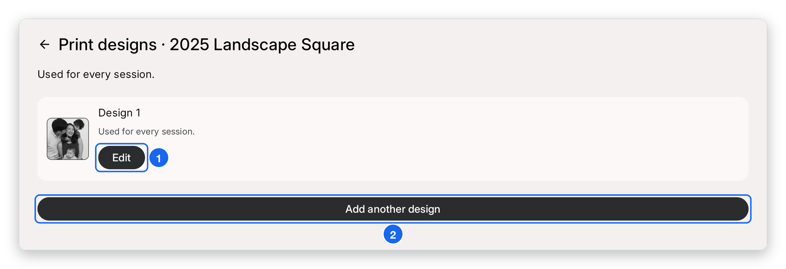
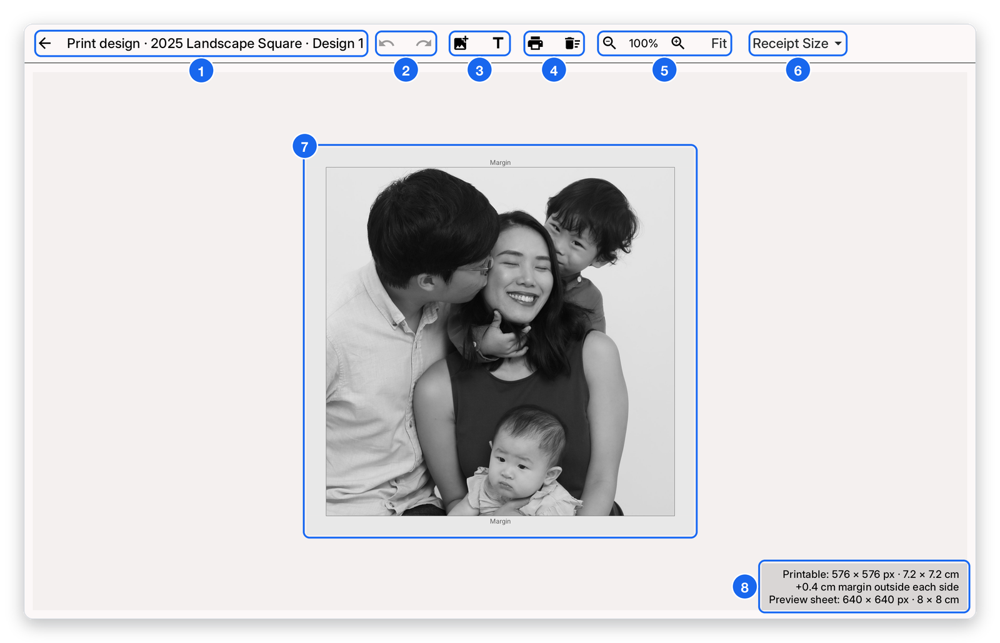

# Template editor

Each theme has its own print design. Here is how to get to the editor.

1. Open **Print Customisation** in the sidebar.
2. Tap **Manage print designs**.
3. Tap **Edit** next to the design you want to change.

1. **Edit** — opens the template editor for this design.
2. **Add another design** — adds an extra print design to the theme. Use the arrow at the top left to go back.

## The editor

### Toolbar

1. **Back arrow and design name** — go back to your list of designs. The title shows the theme and the design you are editing.
2. **Undo and Redo** — step back or forward through your recent edits.
3. **Add image and Add text** — place a new image or text layer on the receipt.
4. **Print and Delete** — send a test print, or remove the selected layer.
5. **Zoom and Fit** — zoom the canvas in or out, or fit the whole receipt on screen.
6. **Receipt Size** — choose the receipt size for this design.

### Canvas

7. **Print canvas** — arrange your photo and text layers inside the printable area. Drag a layer to move it.
8. **Printable area** — shows the printable size (px and cm), the margin and the preview sheet size.

Each theme can have its own print template. Changes here apply to the theme currently selected under Booth Customisation.
