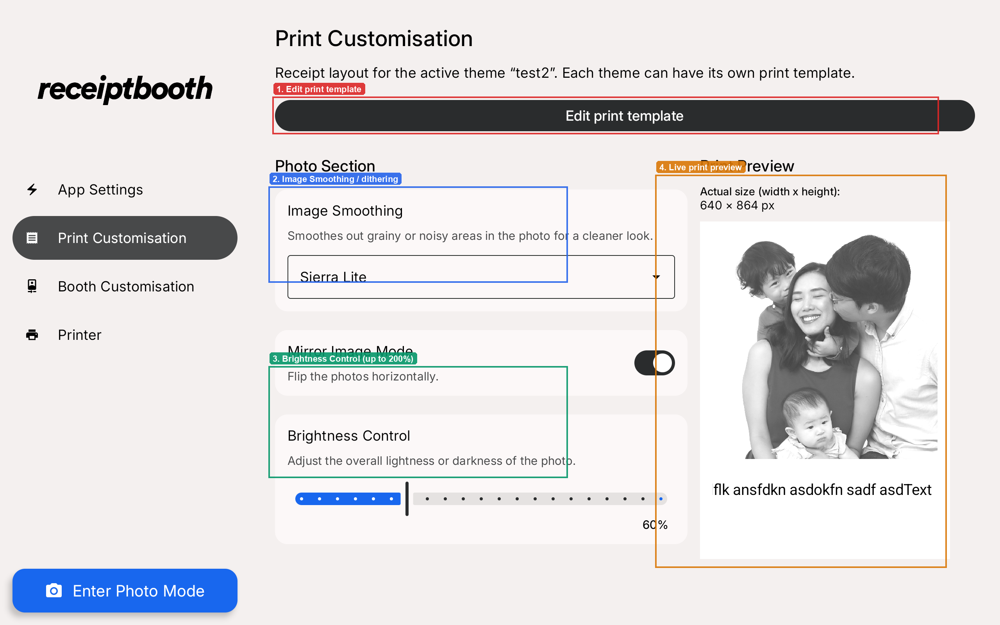
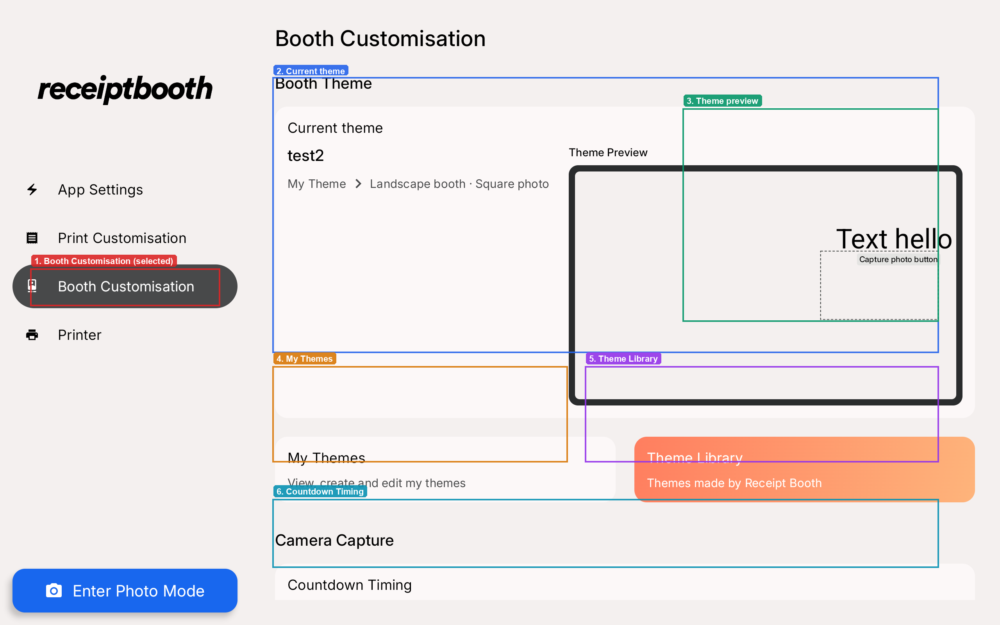

# Interface and print templates

The default interface and print templates are fully customisable. You can add text and images directly in the [template editor](./template-editor.mdx) in the app, or design a template on your computer in an app like Canva and bring it into the app.

## In-app print customisation

Open **Print Customisation** from the sidebar to adjust how photos are processed for print and to open the template editor.

1. **Edit print template** — opens the canvas editor for the active theme’s receipt layout.
2. **Image Smoothing** — dithering style (for example Sierra Lite) for cleaner mid-tones and dark areas.
3. **Brightness Control** — lighten or darken the printed photo (up to 200%).
4. **Live print preview** — approximate receipt output for the active theme.

Booth themes (capture / review screens) are managed under **Booth Customisation**:

1. **Booth Customisation** — selected in the sidebar.
2. **Current theme** — name and type of the active booth theme.
3. **Theme preview** — how the capture screen is laid out.
4. **My Themes** — view, rename, delete, and sort your saved themes.
5. **Theme Library** — themes provided by Receipt Booth.
6. **Countdown Timing** — delay before the photo is taken in photo mode.

## Canva

1. Save your artwork as png and share it with your tablet. We use apps like LocalSend (https://localsend.org/) to easily share these artworks between our phones/computers to the tablets.
2. Set as a new background layer in the template editor and do not move it.

- Camera screen template: https://canva.link/939f8zbqtc0v1ib
- Photo review screen template: https://canva.link/o0lqqltutmu3y7g
- Print design template: https://canva.link/5be3n581jb5i1zs

## Photoshop

Photoshop templates are coming soon. To make your own, create a canvas of 1340 x 800 px.

## Figma

Figma templates are coming soon. To make your own, create a canvas of 1340 x 800 px.
