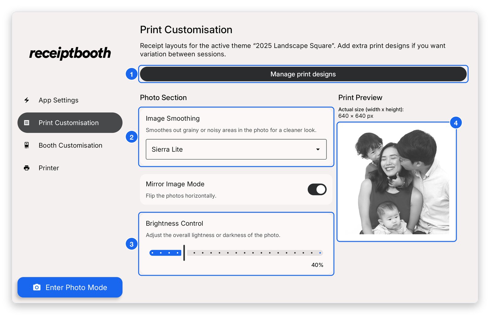
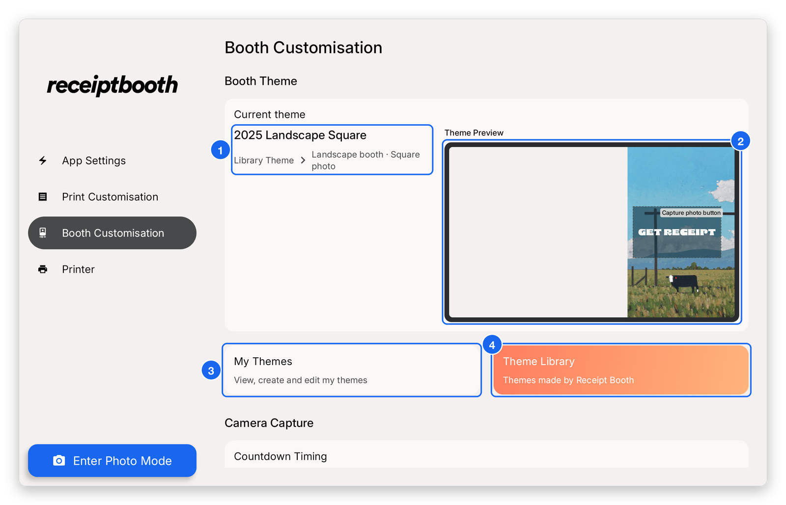
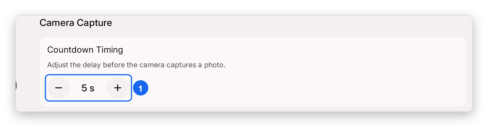

# Interface and print templates

The default interface and print templates are fully customisable. You can add text and images directly in the [template editor](./template-editor.mdx) in the app, or design a template on your computer in an app like Canva and bring it into the app.

## In-app print customisation

Open **Print Customisation** from the sidebar to change how photos are processed for print, and to manage your print designs.

1. **Manage print designs** — opens the list of print designs for the active theme, where you can open the [template editor](./template-editor.mdx).
2. **Image Smoothing** — the dithering style (for example Sierra Lite). It gives cleaner mid-tones and dark areas.
3. **Brightness Control** — lighten or darken the printed photo (up to 200%).
4. **Print preview** — an approximate view of the printed receipt for the active theme.

Booth themes (the capture and review screens) are managed under **Booth Customisation**.

1. **Current theme** — the name and type of the theme your booth is using now.
2. **Theme preview** — how the capture screen is laid out.
3. **My Themes** — view, rename, delete and sort your saved themes.
4. **Theme Library** — themes made by Receipt Booth.

Scroll down to **Camera Capture** to set the countdown before each photo.

1. **Countdown Timing** — the delay before the camera takes the photo in photo mode. Tap **−** or **+** to change it.

## Canva

1. Save your artwork as png and share it with your tablet. We use apps like LocalSend (https://localsend.org/) to easily share these artworks between our phones/computers to the tablets.
2. Set as a new background layer in the template editor and do not move it.

- Camera screen template: https://canva.link/939f8zbqtc0v1ib
- Photo review screen template: https://canva.link/o0lqqltutmu3y7g
- Print design template: https://canva.link/5be3n581jb5i1zs

## Photoshop

Photoshop templates are coming soon. To make your own, create a canvas of 1340 x 800 px.

## Figma

Figma templates are coming soon. To make your own, create a canvas of 1340 x 800 px.
