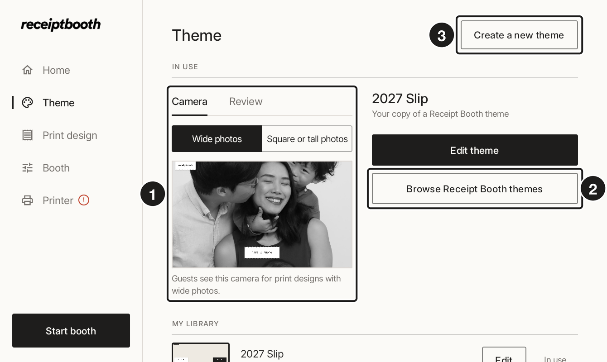
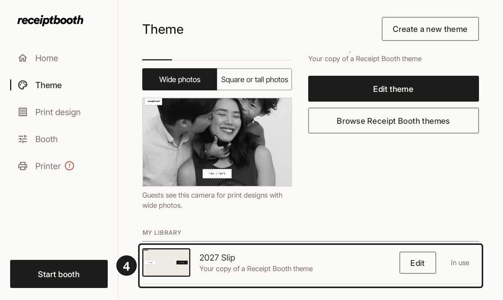
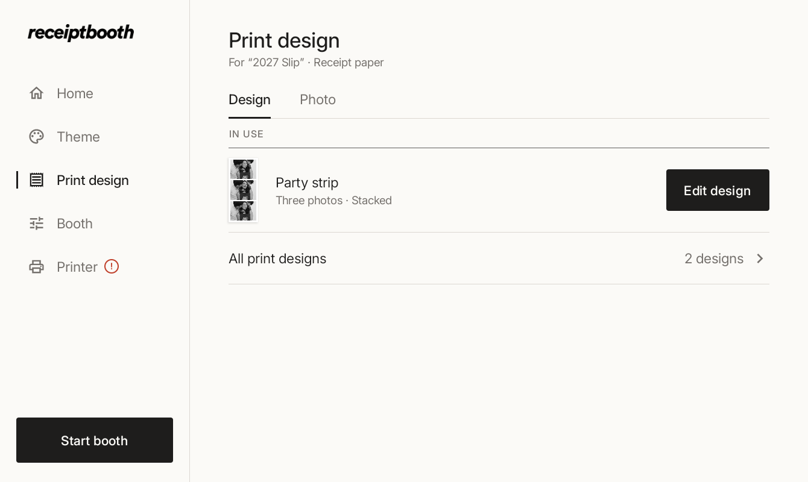
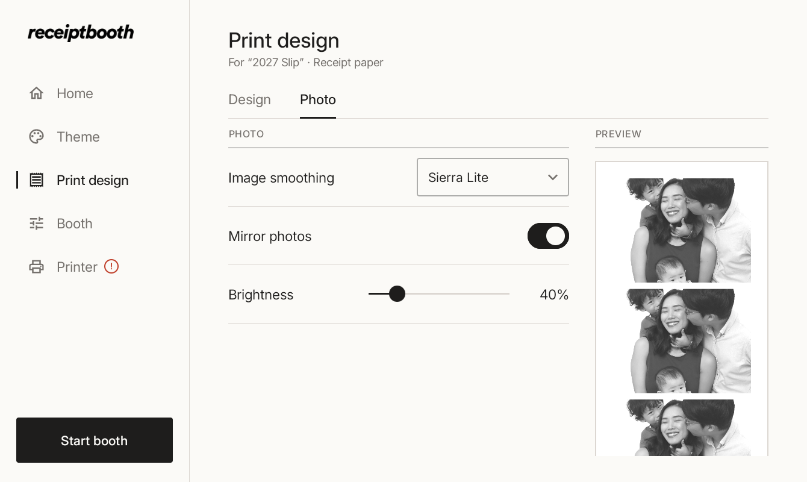
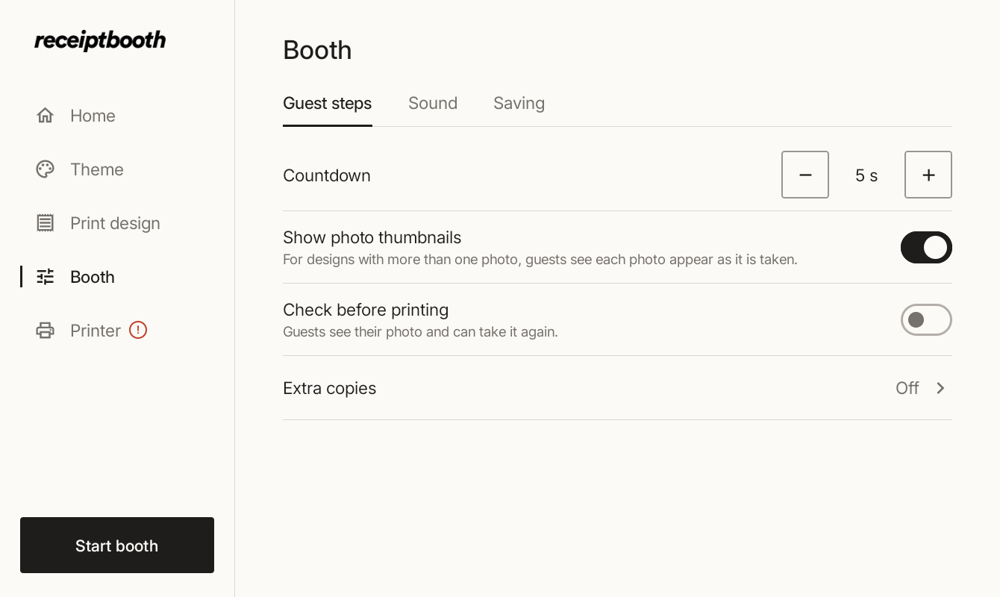

# Interface and print templates

Every theme and print design can be changed. Add text and pictures in the [theme editor](./theme-editor.mdx) and the [print design editor](./template-editor.mdx), or design artwork in an app like Canva and bring it in.

## Theme: the look of the guest screens

Open **Theme** in the menu.

1. **In use** — the theme your booth uses now, with a picture of the screens guests see. Tap the tabs over the picture to look at each screen. Under the name it says where the theme came from: **One of my themes**, or **Your copy of a Receipt Booth theme**. Tap **Edit theme** to change it.
2. **Browse Receipt Booth themes** — themes made by Receipt Booth. See [Themes from Receipt Booth](#themes-from-receipt-booth).
3. **Create a new theme** — at the top right. Give it a name under **New theme** and tap **Create**. It opens in the [theme editor](./theme-editor.mdx).
4. **My library** — your themes. On a row, tap **Edit** to change it, or **Use** to put it on the booth. The theme in use says **In use**.

Tap a row in **My library** to open its details. There you can **Use this theme**, **Edit theme**, **Manage print designs**, **Rename** or **Delete**. The app asks first before it deletes a theme: "and its print designs will be permanently deleted. This cannot be undone."

### Themes from Receipt Booth

**Browse Receipt Booth themes** opens **Themes**. It has two tabs, **Receipt Booth library** and **My library**.

- On **Receipt Booth library**, tap a theme, then **Add to my library**. It goes into your library and is put in use, and the message says so. The original is never changed. A theme already in your library says **In your library**, with **Open in my library**.
- On **My library**, **Sort** puts your themes in order: **Name (A–Z)**, **Name (Z–A)**, **Newest first** or **Oldest first**. **New theme** makes a theme of your own.
- Library themes update by themselves when the tablet has internet ("Updating themes…"). With no internet: "No internet connection. Showing themes saved on this tablet." Connect to the internet to download more.
- **Get the original again** (in the details of a copy of a Receipt Booth theme) adds a fresh copy of the original to your library and puts it in use. Your own copy stays as it is.

## Print design: what is printed

Open **Print design** in the menu. It has two tabs, **Design** and **Photo**. The line under the title says which theme and which paper you are editing, for example "For “Café” · Receipt paper".

- **Design** — **In use** shows the design guests get, with its layout (for example "One photo · Square") and **Edit design**, which opens the [print design editor](./template-editor.mdx). If several designs take turns it says how many and how they are chosen. **All print designs** lists every design for this theme.
- **Photo** — how photos are processed for print: **Image smoothing** (the dithering style, for example Sierra Lite, gives cleaner mid-tones and dark areas), **Mirror photos**, and **Brightness** (lighten or darken the printed photo, up to 200%). **Preview** shows the effect. It says "Making the preview…" while it works.

## Booth: what guests do

Open **Booth** in the menu. It has three tabs, **Guest steps**, **Sound** and **Saving**. Every change saves at once.

{/* TODO(boss): the picture (receipt booth) shows no Drawing row, but the list below says Drawing shows when Check before printing is on. The 1.1 candidate notes say Drawing is for Instax booths only. Confirm, then fix the line or the list. */}

- **Guest steps**
  - **Countdown** — the delay before the camera takes the photo. Tap **−** or **+**, from 1 to 10 seconds.
  - **Show photo thumbnails** — "For designs with more than one photo, guests see each photo appear as it is taken." On by default. Guests see numbered thumbnails beside the camera that fill in as each photo is taken. With one photo it does nothing. Switch it off to go without.
  - **Check before printing** — "Guests see their photo and can take it again."
  - **Drawing** — "Guests can draw on the photo before printing." It shows only when **Check before printing** is on.
  - **Extra copies** — opens its own page. The row shows **Off** or, for example, "Up to 3 copies". See [Reprint photos](../running-an-event/reprint-photos.mdx).
- **Sound** — **Sounds** on or off. When on, pick a **Shutter** and a **Countdown** sound and tap **Play** to hear it.
- **Saving** — **Save prints to the gallery** ("A copy of every print goes to the tablet's photos."), **Include the print design** ("Save the full print, not just the photo."), and the [Online photos](./online-photos.mdx) settings.

## Canva

1. Save your artwork as png and share it with your tablet. We use apps like LocalSend (https://localsend.org/) to easily share these artworks between our phones/computers to the tablets.
2. Add it as a picture in the editor. In the theme editor, add it under **Background** and choose **Fill the screen**. In the print design editor, add it with **Picture** and use **Send back** so it sits behind the other things.

{/* TODO(boss): check these two steps on a tablet. The 1.0 wording was "Set as new background layer in the template editor and do not move it." */}

- Camera screen template: https://canva.link/939f8zbqtc0v1ib
- Photo review screen template: https://canva.link/o0lqqltutmu3y7g
- Print design template: https://canva.link/5be3n581jb5i1zs

## Photoshop

Photoshop templates are coming soon. To make your own, create a canvas of 1340 x 800 px.

## Figma

Figma templates are coming soon. To make your own, create a canvas of 1340 x 800 px.
