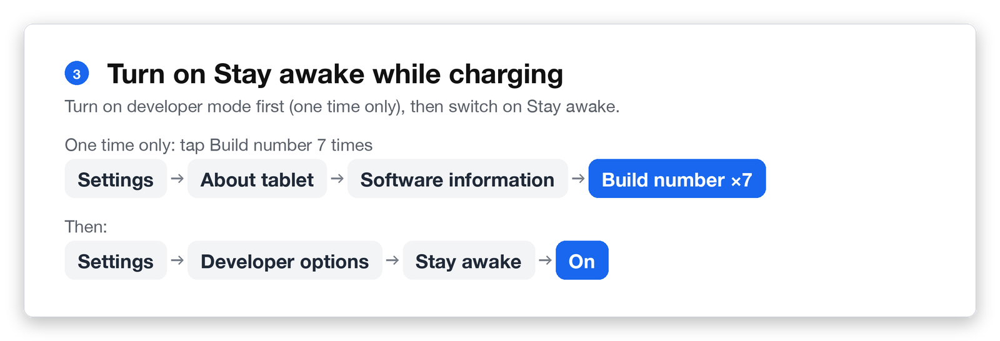

# Tablet settings

The tablet has power-saving features that dim or switch off the screen. Change these three settings once so the booth stays awake for guests.

{/* TODO(boss): replace the step graphics below with real Samsung One UI screenshots from the booth tablet (Galaxy Tab A9 / A11): Settings > Display (Adaptive brightness), Display > Screen timeout, About tablet > Software information > Build number, Developer options > Stay awake. The Android emulator cannot show Samsung's menus, so these graphics show the menu path only. */}

## 1. Turn off adaptive brightness

This lets you control the screen brightness yourself.

1. Open **Settings**.
2. Tap **Display**.
3. Switch off **Adaptive brightness**.

## 2. Increase the screen timeout

1. Open **Settings** → **Display** → **Screen timeout**.
2. Choose **10 minutes**.

## 3. Turn on Stay awake while charging

First, turn on developer mode. You only need to do this once.

1. Open **Settings** → **About tablet** → **Software information**.
2. Tap **Build number** 7 times in a row until you see "Developer mode has been turned on."

Then switch on Stay awake.

3. Go back to the main **Settings** menu and open **Developer options** (at the very bottom).
4. Switch on **Stay awake**.

:::note
Stay awake only works while the tablet is charging, so keep it connected to power as described in [Unboxing and setup](./unboxing-and-setup.mdx).
:::
