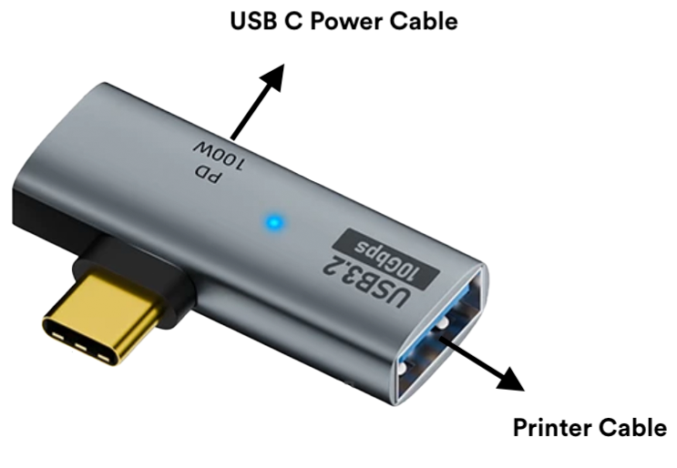

# Unboxing and setup

Welcome to your Receipt Booth. This page takes you from a sealed box to a booth that is ready for its first photo. Allow about 15 minutes.

## What's in the box

1. Booth casing
2. Samsung tablet
3. Printer (pre-installed inside the booth)
4. Power strip (the two plugs inside the booth) and power cable
5. Tablet connectors, packed separately in a small sealed bag
6. Starter receipt rolls and sticker paper rolls

{/* TODO(boss): company.md says "2 paper rolls" in the box; this list says "starter receipt rolls and sticker paper rolls". Confirm exact quantities. */}

If anything is missing, [contact support](../contact-support.mdx) and we will sort it out.

## Set up your booth

1. Unpack everything. Take extra care with the bag of connectors, as they are fragile.
2. Plug the tablet connector into the tablet's USB-C port.
3. Plug the white USB-C power cable into the charging port on the tablet connector.
4. Plug the black USB 2.0 data cable from the printer into the bottom of the tablet connector.

   

5. Check that no cable inside the booth is left unconnected.
6. Plug the power cable in at the back of the booth. The printer should switch on automatically and the tablet should start charging. If the printer stays off, flip the switch inside the booth marked **I** and **O**.
7. Slide the tablet in from the top of the booth window, with the camera on the left and the screen facing outwards.
8. Turn on the tablet and complete its setup. You need a Google account to download the Receipt Booth app from the Play Store, so create one if you do not have one yet.
9. Install the app from the [Play Store](https://play.google.com/store/apps/details?id=com.receiptbooth.receiptbooth).

:::tip Keep the tablet charging
The tablet needs to be charging and connected to the printer at the same time, so it never runs out of battery at your shop or event.
:::

## Next steps

- Stop the screen from dimming or sleeping: [Tablet settings](./tablet-settings.mdx)
- Check the printer is connected: [Printer settings](../printer-and-paper/printer-settings.mdx)
- Make it yours: [Interface and print templates](../app/templates.mdx)
- Using the booth at an event: [Event checklist](../running-an-event/event-checklist.mdx)
