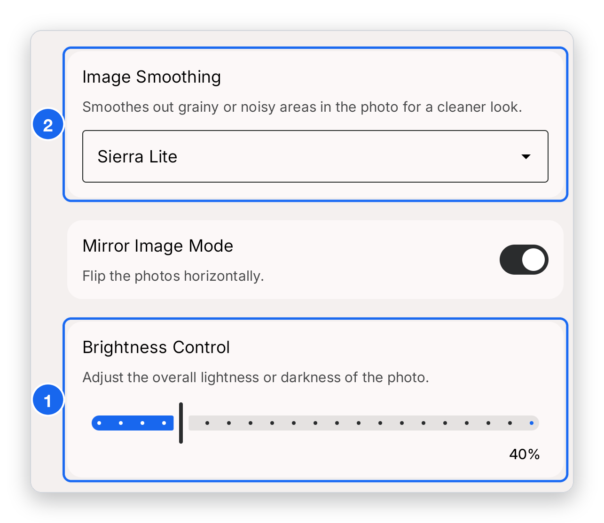
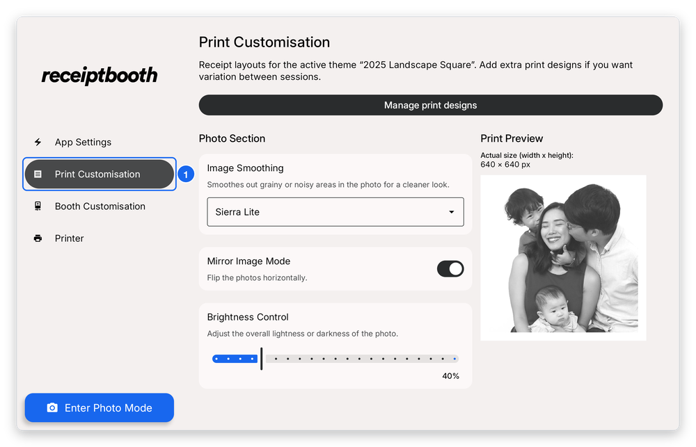

# Lines on prints

The direction of the lines tells you the cause.

## Horizontal lines

Horizontal lines on your photos usually come from the brightness of the room.

1. Move the booth to a brighter area, and/or
2. Open **Print Customisation** and increase **Brightness Control**. It goes up to 200%.
3. Optionally, change **Image Smoothing** to reduce banding in darker prints.

1. **Brightness Control** — drag the slider to the right to make prints lighter (up to 200%).
2. **Image Smoothing** — open the drop-down and try a different option if the darker areas still look stripy.

Not sure where to find it? It is under **Print Customisation** in the sidebar.

1. **Print Customisation** — tap it in the sidebar to open these settings.

## Vertical lines

Vertical lines point to a printer head that is not working properly. Your booth may need a maintenance check at a service centre. [Contact support](../contact-support.mdx) first, with a photo of the print, and we will advise.
