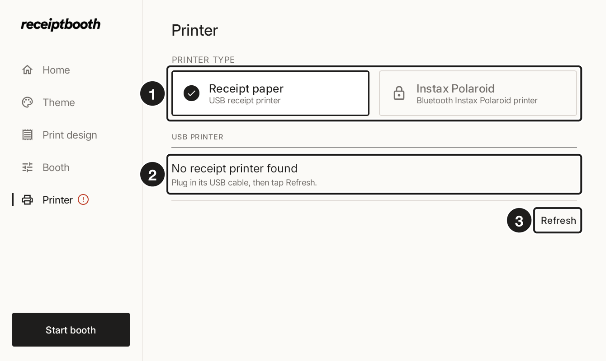
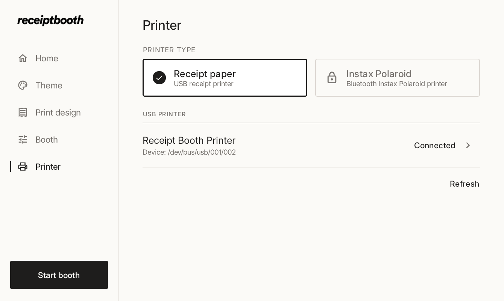
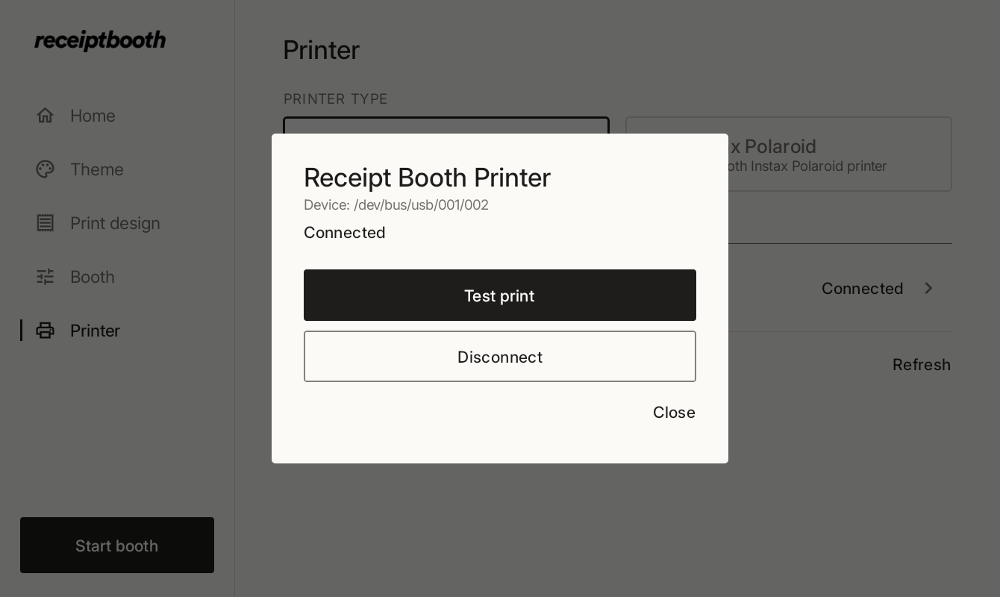

# Printer settings

Check the printer is connected and run a test print.

1. Turn on your Receipt Booth. The printer should switch on automatically. If it does not, flip the hardware switch inside the booth.
2. The Receipt Booth app should launch automatically once the printer is on.
3. Open **Printer** in the menu. At the top, **Receipt paper** (USB receipt printer) should be the one chosen.
4. Under **USB printer**, your printer is listed with its name. When it is connected, **Connected** is shown beside it.
5. If it is listed but not connected, the page says "The receipt printer is plugged in but not connected. Tap it, then tap Connect." Tap the printer, then tap **Connect**.
6. Tap the printer and then **Test print** to print your current settings. The same window has **Disconnect** and **Close**.

**Home** also shows the printer. A red **!** next to **Printer** means it needs you, and the line under it says what to do, for example "Not connected. Plug in its USB cable."

## What the Printer page looks like

1. **Printer type** — **Receipt paper** (USB receipt printer, the booth's own printer) or **Instax Polaroid** (needs an access code; its guide is coming).
2. **No receipt printer found** — what you see until the printer is switched on and connected. Under it: "Plug in its USB cable, then tap Refresh."
3. **Refresh** — searches for printers again. The app also keeps checking by itself.

When the printer is connected, the Printer page lists it by name with **Connected** beside it. Tap it to open its window, with **Test print**, **Disconnect** and **Close**.

## If it says "No receipt printer found"

Check each of these:

1. The printer is powered on (the hardware switch inside the booth).
2. The USB data cable runs from the printer to the tablet connector.
3. The tablet is charging through the tablet connector.

Still not connecting? See [Troubleshooting](../troubleshooting.mdx#the-printer-is-not-connecting).
