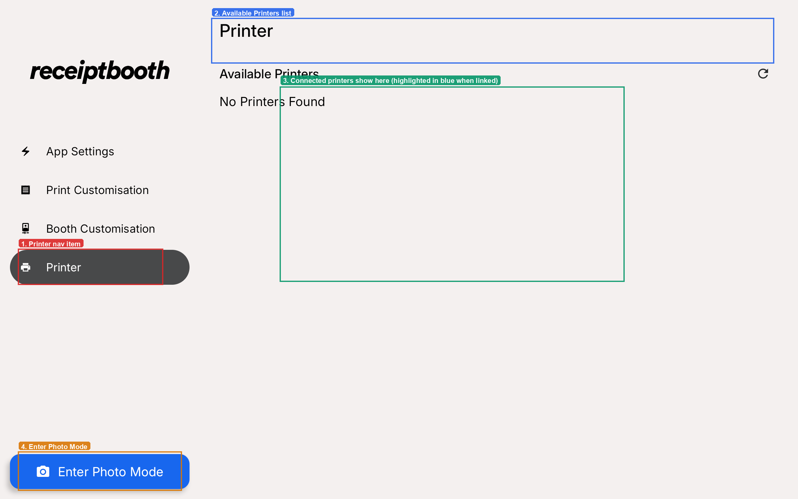

# Printer settings

Use the **Printer** screen to check the printer is connected and to run a test print.

1. Turn on your Receipt Booth. The printer should switch on automatically. If it does not, flip the hardware switch inside the booth.
2. The Receipt Booth app should launch automatically once the printer is on.
3. Open **Printer** in the sidebar. The connected printer is highlighted in blue.
4. Tap the printer once to see its information.
5. Tap **Test print** to print your current settings.

## If it says "No Printers Found"

Check each of these:

1. The printer is powered on (the hardware switch inside the booth).
2. The USB data cable runs from the printer to the tablet connector.
3. The tablet is charging through the tablet connector.

Still not connecting? See [Troubleshooting](../troubleshooting.mdx#the-printer-is-not-connecting).
