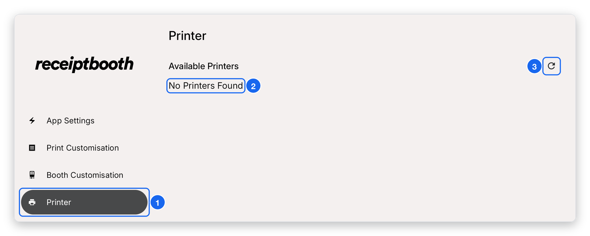

# Printer settings

Use the **Printer** screen to check the printer is connected and to run a test print.

1. Turn on your Receipt Booth. The printer should switch on automatically. If it does not, flip the hardware switch inside the booth.
2. The Receipt Booth app should launch automatically once the printer is on.
3. Open **Printer** in the sidebar. The connected printer is highlighted in blue.
4. Tap the printer once to see its information.
5. Tap **Test print** to print your current settings.

## What the Printer screen looks like

This is the screen before the printer is connected, so it says **No Printers Found**. Once the printer is on and connected, it appears in the list instead.

1. **Printer** — tap it in the sidebar to open this screen.
2. **No Printers Found** — what you see until the printer is switched on and connected.
3. **Refresh** — searches for printers again. The app also keeps checking by itself.

{/* TODO(boss): add a screenshot of the Printer screen with a real printer connected (highlighted in blue, plus the printer info and Test print). Needs the booth tablet with the printer attached; the emulator cannot fake a USB printer. */}

## If it says "No Printers Found"

Check each of these:

1. The printer is powered on (the hardware switch inside the booth).
2. The USB data cable runs from the printer to the tablet connector.
3. The tablet is charging through the tablet connector.

Still not connecting? See [Troubleshooting](../troubleshooting.mdx#the-printer-is-not-connecting).
