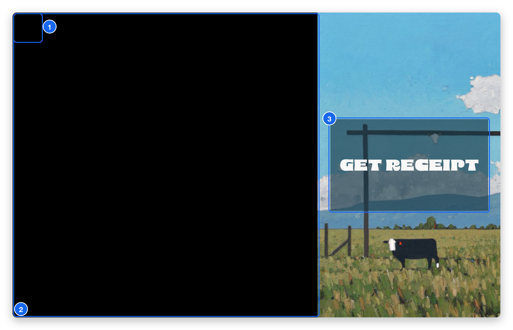

# Exit photo mode

Photo mode is the guest-facing screen, so there is no visible exit button. To get back to settings:

1. Make sure the booth is on the **photo screen** (the live camera view).
2. Tap the top-left corner of the screen **5 times quickly**.

If the booth is on the **photo review** screen instead, tap once to return to the photo screen first, then tap the corner five times.

1. **Exit corner** — the top-left corner. There is nothing to see there on purpose. Tap it five times quickly (within 2 seconds) to leave photo mode and return to settings.
2. **Camera area** — your guests see the live camera here. It is black in this picture because it was taken on a test tablet with no camera. The layout depends on your theme.
3. **Theme artwork and button** — the look of your booth theme, with the button guests tap to take their photo. This example uses the "2025 Landscape Square" theme. Yours shows your own theme.

Nothing happens? The five taps need to be quick and on the photo screen. See [Troubleshooting](../troubleshooting.mdx#i-cannot-exit-photo-mode).
