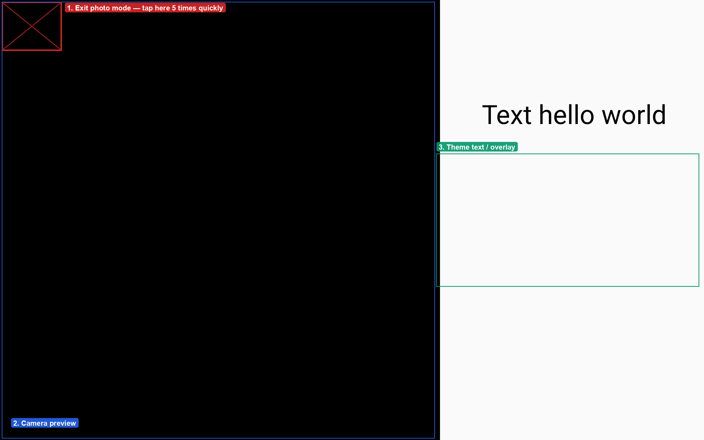

# Exit photo mode

Photo mode is the guest-facing screen, so there is no visible exit button. To get back to settings:

1. Make sure the booth is on the **photo screen** (the live camera view).
2. Tap the top-left corner of the screen **5 times quickly**.

If the booth is on the **photo review** screen instead, tap once to return to the photo screen first, then tap the corner five times.

1. **Exit corner** — tap this top-left area five times in quick succession to leave photo mode and return to settings.
2. **Camera preview** — the live camera feed (the layout depends on the active theme).
3. **Theme overlay** — custom text and graphics from your booth theme.

Nothing happens? The five taps need to be quick and on the photo screen. See [Troubleshooting](../troubleshooting.mdx#i-cannot-exit-photo-mode).
