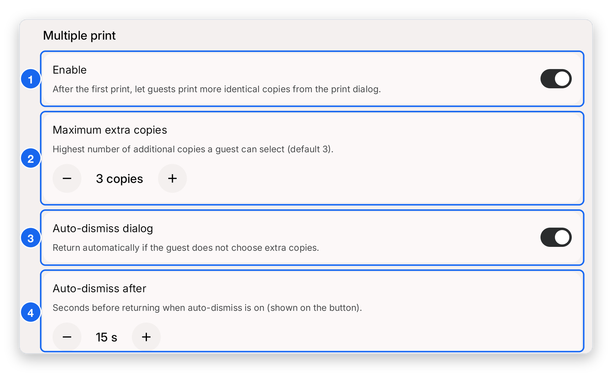

# Reprint photos

Guests can print extra copies of their photo after the first one. In the app this is called **Multiple print**. Turn it on and set a timeout in **Booth Customisation**.

1. Open **Booth Customisation** in the sidebar and scroll down to **Multiple print**.
2. Switch **Enable** on. After the first print, guests can print more identical copies.
3. Set **Maximum extra copies**, the most extra copies a guest can pick. The default is 3.
4. Switch **Auto-dismiss dialog** on. This closes the extra-copies screen by itself if the guest does not choose, because guests often forget to dismiss it.
5. Set **Auto-dismiss after**, the number of seconds before it closes.

1. **Enable** — turns extra copies on.
2. **Maximum extra copies** — tap **−** or **+** to change the limit.
3. **Auto-dismiss dialog** — returns to the photo screen automatically if the guest does not choose extra copies.
4. **Auto-dismiss after** — how many seconds it waits before closing. This only applies when auto-dismiss is on.

:::tip
Each extra copy uses paper. Keep a spare roll nearby at busy events. See [Paper and reorders](../printer-and-paper/paper-and-reorders.mdx).
:::
